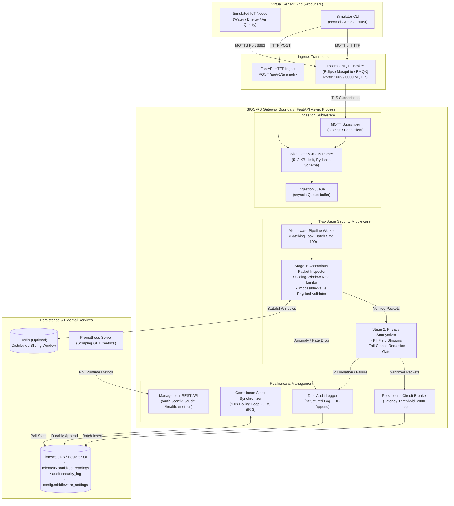
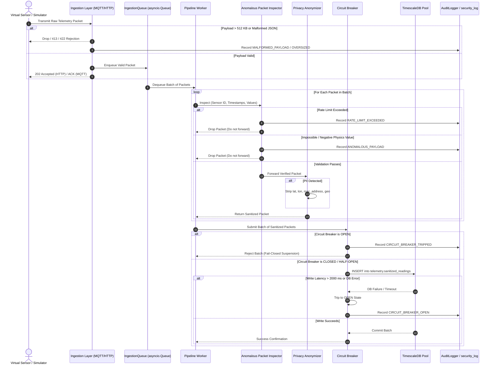

# SIGS-RS Architecture Specification

## 1. System Overview

**Secure IoT Gateway Simulation for Resource Sensing (SIGS-RS)** is an asynchronous telemetry ingestion gateway and security middleware engine. It models a municipal sensor grid across water, energy, and air quality domains, enforcing rigorous security inspection, rate-limiting, privacy anonymization, and durable persistence.

```
                              ┌──────────────────────────────────────────────┐
                              │               SIGS-RS Gateway                │
┌─────────────────────────┐   │                                              │   ┌──────────────────────────┐
│ Virtual Sensor Grid     │───┼─► Ingestion Layer (MQTT 8883 / HTTP REST)    │   │ PostgreSQL + TimescaleDB │
│ (Water, Energy, Air Q.) │   │       │                                      │   │                          │
└─────────────────────────┘   │       ▼ asyncio.Queue                        │   │ telemetry.sanitized_readings
                              │   Anomalous Packet Inspector                 │   │ (Hypertable partitioned) │
                              │       │ (Sliding-window + Impossible-values) │   │                          │
                              │       ▼                                      │   │ audit.security_log       │
                              │   Privacy Anonymizer                         │───┼─► (Immutable WORM trig.) │
                              │       │ (PII stripping: geo, MAC, device)    │   │                          │
                              │       ▼                                      │   │ config.middleware_settings
                              │   Circuit Breaker ──► Repository Pool        │   └──────────────────────────┘
                              └──────────────────────────────────────────────┘
```

---

## 2. Diagram 1: System Architecture

The following diagram depicts the operational boundaries of the SIGS-RS gateway, separating the external producer layer, the ingestion surface, internal asynchronous queues, the two-stage security pipeline, persistence engines, and external observability scrapers.



---

## 3. Component Breakdown & Responsibilities

### 3.1 Virtual Sensor Grid Simulator (`simulator/`)
- Generates reproducible streams of water, energy, and air quality telemetry.
- Models physical sensor behavior, metadata generation, and configurable network payloads.
- Injects anomalous patterns (rate attacks, impossible physics values, malformed JSON, burst traffic) via CLI flags.

### 3.2 Ingestion Layer (`src/sigs_rs/ingestion/`)
- **MQTT Subscriber (`mqtt_sub.py`):** Asynchronous subscriber utilizing `aiomqtt`. Connects over TLS 1.2+ (SRS REQ-TI-1). Enforces 512 KB payload size guards (REQ-TI-3).
- **HTTP Ingestion (`http_ingest.py`):** REST API endpoints (`POST /api/v1/telemetry`, `POST /api/v1/telemetry/batch`). Implements low-latency streaming payload size checks.
- **Ingestion Queue (`buffer.py`):** In-memory bounded `asyncio.Queue` (SRS REQ-TI-4). Decouples transport socket ingestion from synchronous middleware processing.

### 3.3 Two-Stage Security Middleware (`src/sigs_rs/middleware/`)
1. **Anomalous Packet Inspector (`inspector.py`):**
   - **Sliding-Window Rate Limiter (`sliding_window.py`):** Enforces rate thresholds per sensor (default: 50 packets per 10 seconds). Employs memory-safe in-process deques or Redis Lua scripts.
   - **Impossible-Value Detector (`payload_validator.py`):** Enforces thermodynamic and physical boundary conditions (e.g., non-negative energy/flow, AQI between 0 and 500, valid unit mappings).
   - Rejection semantics: dropped packets are immediately audited and **never forwarded to the Anonymizer**.
2. **Privacy Anonymizer (`anonymizer.py`):**
   - Enforces PII stripping (SRS REQ-PA-1, REQ-PA-4). Strips `latitude`, `longitude`, `lat`, `lon`, `mac_address`, `device_id`, and `geo` objects.
   - Operates under fail-closed error handling: if sanitization fails or unexpected PII remains, the packet is discarded and an audit event is generated.
3. **Pipeline Worker (`pipeline.py`):**
   - Coordinates continuous batch drainage (`batch_size=100`, `drain_timeout=0.05s`) from the `IngestionQueue`.
   - Passes batches through Inspector → Anonymizer → Circuit Breaker → Database.

### 3.4 Persistence Subsystem (`src/sigs_rs/persistence/`)
- **Database Pool (`database.py`):** Asyncpg connection pool with SSL enforcement and fallback to `InMemoryDatabasePool` in test environments.
- **Telemetry Repository (`repository.py`):** Batch insertion into `telemetry.sanitized_readings` hypertable.
- **Circuit Breaker (`circuit_breaker.py`):** Monitors database write latency. If query latency exceeds threshold (2,000 ms), trips to `OPEN`, immediately suspending ingestion to prevent resource exhaustion (SRS REQ-SF-2).
- **Database Schema (`schema.sql`):**
  - `telemetry.sanitized_readings`: Hypertable partitioned by timestamp `ts` at 1-day intervals.
  - `audit.security_log`: Security event log enforced as append-only via database trigger (`trg_audit_immutable`).
  - `config.middleware_settings`: Key-value configuration store for runtime threshold updates.

### 3.5 Management, Auth, and Observability (`src/sigs_rs/management/`, `auth/`, `observability/`)
- **Authentication (`auth/`):** OAuth 2.0 / JWT Bearer token authentication (SRS REQ-SE-2). Role-Based Access Control (RBAC) with roles: `security_engineer`, `compliance_auditor`, `qa_tester`, `backend_developer`, `devops`.
- **Audit Logging (`management/audit_logger.py`):** Emits structured application logs and writes immutable records into `audit.security_log`.
- **Health & Metrics (`management/health.py`, `observability/metrics.py`):** Exposes `/health` (liveness), `/ready` (readiness), and `/metrics` (Prometheus text exposition + JSON).

---

## 4. Diagram 2: Telemetry Sequence

The following sequence diagram details the complete per-packet processing lifecycle, highlighting drop and audit paths when an anomaly, malformed schema, or circuit trip occurs.



---

## 5. Architectural Invariants

The SIGS-RS architecture guarantees the following core invariants across all deployment modes:

1. **Zero Raw Persistence:** Under no circumstances does raw, uninspected, or unsanitized telemetry enter the persistent database layer. All database ingestion paths must traverse the `PipelineWorker`.
2. **Sequential Stage Ordering:** The `Inspector` precedes the `Anonymizer`. Dropped packets (anomalous values or rate attacks) are discarded before entering PII stripping, preserving forensic event records while minimizing unnecessary processing.
3. **Fail-Closed Execution:** Any unhandled exception within the middleware pipeline, a database disconnection, or an open circuit breaker transitions the gateway into `FAIL_CLOSED` status, setting `/health` to HTTP 503 and halting further telemetry ingress.
4. **Audit Immutability:** Audit records created during startup, auth failures, drops, or guideline revisions are permanently protected against UPDATE and DELETE operations by database triggers.

---

## 6. Background Concurrency & Lifecycle

The application lifecycle (`lifespan` in `src/sigs_rs/main.py`) coordinates four concurrent background tasks:

| Background Task Name | Coroutine Target | Purpose | Concurrency Model |
| :--- | :--- | :--- | :--- |
| `middleware-pipeline` | `MiddlewarePipeline.run()` | Continuously drains `IngestionQueue`, executes middleware, and batches writes. | Asyncio task with fatal exception callback triggering `fail_closed = True`. |
| `mqtt-subscriber` | `MQTTSubscriber.start()` | Maintains persistent TLS socket to MQTT broker and dispatches incoming messages. | Asyncio task with auto-restart supervisor. |
| `sliding-window-cleanup` | `_sliding_window_cleanup_loop()` | Periodically sweeps expired sensor timestamp deques from memory. | Asyncio periodic sleep loop (default interval: 60 s). |
| `compliance-sync` | `_compliance_sync_loop()` | Periodically polls `config.middleware_settings` for cross-instance compliance lockout (SRS BR-3). | Asyncio periodic sleep loop (1.0 s interval). |
