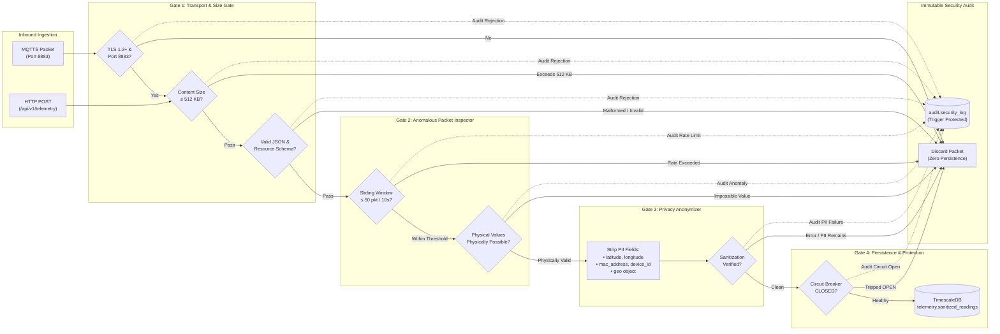

# SIGS-RS Security & Threat Modeling Architecture

## 1. Overview & Threat Model

**SIGS-RS (Secure IoT Gateway Simulation for Resource Sensing)** operates at the edge-to-cloud boundary of a municipal IoT infrastructure. Community sensors deployed in public and semi-public environments measure vital resources (water distribution, grid energy, and atmospheric air quality).

### 1.1 Threat Model & Attack Vectors

The gateway defends against several core threat categories derived from the authoritative SRS (`docs/SRS.pdf` / `docs/SRS.txt`):

1. **Denial-of-Service (DoS) & Buffer Exhaustion:** Malicious or malfunctioning sensors transmitting oversized packets (> 512 KB) or rapid packet bursts designed to exhaust memory or CPU.
2. **Sensor Spoofing & Physical Anomaly Injection:** Attackers spoofing sensor identities to inject non-physical or impossible readings (negative water/energy usage, out-of-range AQI) to corrupt municipal dispatch decisions.
3. **Surveillance & PII Infiltration:** Injection of sensitive spatial or device identifiers (GPS coordinates, MAC addresses, hardware serials) embedded within telemetry streams that could compromise citizen privacy.
4. **Privilege Escalation & Unauthorized Reconfiguration:** Unauthorized network clients attempting to alter security thresholds, strip PII definitions, or bypass compliance gates.
5. **Database Saturation & Infrastructure Cascade:** Database latency degradation cascading upstream and exhausting gateway async worker pools.
6. **Regulatory Non-Compliance & Audit Tampering:** Modification of privacy rules without formal audit approval (SRS BR-3), or tampering with historical security audit logs.

---

## 2. Diagram 3: Security Pipeline

The diagram below details the sequential security pipeline enforced across all telemetry ingestion paths.

---

## 3. Defense-in-Depth Security Controls

### 3.1 Transport Security (SRS REQ-TI-1, REQ-SE-1)
- **MQTT Transport:** Production deployment enforces MQTT over TLS 1.2+ exclusively on port 8883. Unencrypted connections on port 1883 are prohibited in production mode.
- **mTLS Capability:** The MQTT subscriber (`src/sigs_rs/ingestion/mqtt_sub.py`) and simulator support mutual TLS (mTLS) with client certificate and private key verification.
- **Database Transport:** Asynchronous PostgreSQL connections enforce SSL mode (`require` in production) via `DATABASE_SSL_MODE` setting.

### 3.2 Ingestion Size Gates (SRS REQ-TI-2, REQ-TI-3)
- **Hard Payload Ceiling:** All ingress paths (MQTT subscriber and HTTP streaming middleware) enforce a strict 512 KB (524,288 bytes) payload ceiling. Oversized payloads are discarded before parsing, preventing memory bloat.
- **JSON Schema Validation:** Incoming payloads are parsed into Pydantic models with strict typing, ISO-8601 UTC timestamp validation, and domain-specific range checks.

### 3.3 Anomalous Packet Inspector (SRS REQ-API-1 to REQ-API-3)
- **Sliding-Window Rate Limiting:** Evaluates a rolling window (default: 50 packets per 10 seconds per sensor ID). Packets exceeding the threshold are dropped immediately. Supported backends include an in-process thread-safe timestamp deque and Redis-backed sliding windows.
- **Impossible-Value Physical Validation:** Rejects sensor readings that violate physical and thermodynamic laws:
  - Water flow: $\ge 0.0\text{ L/min}$, pH between 0.0 and 14.0.
  - Energy consumption: $\ge 0.0\text{ kWh}$, power factor $\le 1.0$.
  - Air quality: $\ge 0.0\text{ AQI}$ and $\le 500.0\text{ AQI}$, relative humidity $\le 100\%$.
- **Strict Drop Invariant:** Packets rejected by the Inspector are discarded immediately. They **never reach the Privacy Anonymizer** or the database.

### 3.4 Privacy Anonymizer (SRS REQ-PA-1, REQ-PA-4)
- **PII Stripping:** Strips all geolocation coordinates (`latitude`, `longitude`, `lat`, `lon`, `geo`), hardware MAC addresses (`mac_address`), and hardware device identifiers (`device_id`).
- **Fail-Secure Architecture:** If anonymization encounters an unexpected exception or fails to remove a configured PII field, the packet is discarded and an audit event is raised.

### 3.5 Authentication & Role-Based Access Control (SRS REQ-SE-2, BR-1)
- **JWT Authentication:** Management endpoints require signed HMAC-SHA256 JWT tokens with configurable expiration (default: 60 minutes).
- **RBAC Enforcement:**
  - Modifying Inspector thresholds or Anonymizer PII lists requires the `security_engineer` role (SRS BR-1).
  - Revising compliance guidelines requires `security_engineer` or `compliance_auditor` (SRS BR-3).
  - Read-only querying of audit logs is limited to `security_engineer`, `compliance_auditor`, `qa_tester`, and `backend_developer`.
  - All unauthorized access attempts generate high-severity audit log entries with the client IP and username.

### 3.6 Compliance Lockout & Multi-Instance Synchronization (SRS BR-3)
- **Automatic Simulation Suspension:** Any revision to privacy compliance guidelines (`PUT /api/v1/config/compliance/guideline`) immediately activates a compliance lockout, suspending all simulation testing across the gateway.
- **Durable Persistence & Polling:** Lockout state is persisted to `config.middleware_settings`. All running gateway instances poll this state at a 1.0-second interval, guaranteeing cross-instance lockout propagation.
- **Formal Audit Signoff:** Testing cannot resume until a formal compliance audit signoff (`POST /api/v1/config/compliance/audit-signoff`) is executed with documented audit notes.

### 3.7 Circuit Breaker & Fail-Closed Protection (SRS REQ-SF-2)
- **Latency Monitoring:** If database write latency exceeds 2,000 ms, the circuit breaker trips from `CLOSED` to `OPEN`.
- **Fail-Closed Semantics:** When open, the gateway refuses new telemetry ingress (HTTP 503), preventing queue overflow and memory starvation.
- **Automatic Recovery:** After a 30-second cooldown, the breaker transitions to `HALF-OPEN`, executing probe queries before resuming traffic.

### 3.8 Audit Log Integrity (SRS REQ-SE-4)
- **Append-Only Immutability:** The `audit.security_log` table is protected by a PostgreSQL trigger function (`audit.prevent_tampering()`) that raises an exception on any `UPDATE` or `DELETE` attempt.
- **Dual Logging:** Audit events are recorded both to stdout/stderr in structured JSON format and into the database.

---

## 4. Verification Boundaries & Known Limitations

To maintain compliance and reporting integrity, the following boundaries and limitations are explicitly documented:

| Security Feature | Implementation State | Verification Boundary & Production Requirement |
| :--- | :--- | :--- |
| **MQTT TLS/mTLS** | Implemented in subscriber and simulator. | **Partially Verified:** TLS context creation, certificate path validation, and port 8883 checks are verified in unit tests. Live broker mTLS handshakes require staging MQTT infrastructure. |
| **Audit Log Immutability** | Enforced by PostgreSQL trigger `trg_audit_immutable`. | **Verified at DB Trigger Level:** Application and database users are blocked from updating or deleting rows. This does **not** constitute hardware/cloud Write-Once-Read-Many (WORM) storage; a database superuser can drop triggers. |
| **Cross-Instance Compliance Lockout** | Enforced locally immediately; synchronized across cluster via DB polling. | **Partially Verified:** Immediate suspension on local instance; up to 1.0-second window across distributed pods prior to database poll synchronization. |
| **OAuth 2.0 Identity Provider** | Seeded admin credential validation and JWT issuance. | **Local Development Implementation:** Production requires integrating an external OpenID Connect / OAuth 2.0 provider (e.g. Keycloak, Okta) per SRS TBD-3. |
| **Secret Management** | Injected via environment variables and Kubernetes Secrets. | Production requires external secret management (HashiCorp Vault, AWS Secrets Manager, or Sealed Secrets). |
